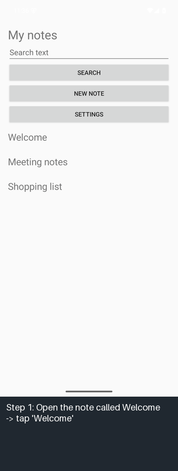
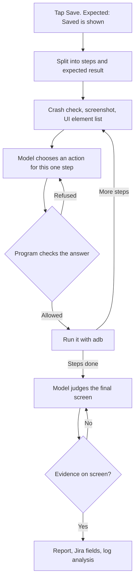

# Android Vision Test Agent

Write an Android test case in plain language. A local vision model carries it out on an emulator, step by step, and
judges the result from the screen. A failure produces a bug report with step screenshots and the device log.

Everything runs on one machine: no API key, no cost, and screenshots and logs never leave it.



*Real screenshots from one run, with captions added. The app ignores the edit, so `Hello` never appears and the agent
reports a failure. The full report is in [`docs/example_run`](docs/example_run/report.md).*

A portfolio project by an Android QA engineer, and the companion to
[Android Bug Triage Agent](https://github.com/Freeze7749/android-bug-triage-agent). This project finds a problem; that
one analyzes the log. Developed with Claude Code.

## Results

Measured on 2026-11-04 with `qwen3.5:4b` on an 8 GB RTX 4070 laptop GPU. The bugs below were never used for tuning, and
the code was committed before this single run.

| Held-out test group (18 runs) | With screenshot | Element list only |
|---|---|---|
| Correct verdicts | **17/18** | 12/18 |
| Bugs detected | **6/6** (95% CI 61-100%) | 5/6 (44-97%) |
| False alarms on healthy runs | **0/12** (95% CI 0-24%) | 4/12 (14-61%) |
| Runs ending as "unsure" | 1 | 1 |
| Average time per test case | 16.8 s | 15.5 s |

The screenshot helped most by avoiding false alarms. It also found the one bug that only shows visually: note titles
in almost the same color as the background, whose text is still present in the UI tree.

### How to read these numbers

- **The app and its bugs were written for this project,** and 18 runs is a small sample. These numbers do not predict performance on a real product. The confidence intervals are wide for this reason.
- **Only an emulator was used.** Nothing here has run on a physical phone.
- **Not every detection came from the model.** 1 of the 6 was a crash caught by a plain program check of the log.
- **Some correct verdicts had weak reasoning:**
  - `invisible_titles`: the verdict was right, but the model said the titles were not displayed instead of describing the low contrast.
  - `freeze_search`: the agent has no timer. It failed the run because the screen still showed the old list while the app was frozen, so a shorter freeze could be missed.
- **The test cases are simple,** at about 3 steps each, in one small app.

### How the score was reached

The test group's score only means something if the path to it is visible:

1. A first design let the model track its own progress. It scored 10/14 and then 8/14 on the dev group, often judging before finishing the steps.
2. A design change followed: the program tracks the steps, and the model does one small job at a time. This scored 12/14. Two more small changes followed, with scores of 11/14 and 14/14. All earlier results are in [`eval/results/history`](eval/results/history).
3. The 14/14 is a tuned dev score, so it is not reported as the result.
4. The code was committed, then the test group ran once with screenshots. Nothing was changed afterwards.
5. The element-list run was interrupted by an emulator freeze. After a restart it continued from its saved progress, with the same code.

## How it works



| File | Job |
|---|---|
| `device.py` | All adb use, in a fixed set of commands. Turns the UI dump into a numbered element list |
| `model.py` | Asks the local model through Ollama, and requires answers in a fixed JSON shape |
| `agent.py` | The test loop, the answer checks and the crash check |
| `report.py` | Markdown report, Jira fields, and optional log analysis with the triage agent |
| `demo-app/` | BuggyNotes, a small Kotlin app with 10 bugs that can be switched on one at a time |
| `eval/run_eval.py` | Runs the test matrix and scores it |

Design choices worth asking about in an interview:

- **The program holds the plan.** A small model is good at "which element does this step need?" and poor at remembering where it is. Moving progress tracking into code raised the dev score more than any prompt change.
- **The model picks a numbered element and never guesses coordinates.** The program takes the coordinates from the UI tree.
- **Answers are checked before anything happens.** The element must exist, its label must match its number if a label is given, and it must support the action.
- **A verdict needs evidence.** A pass or fail must cite elements that exist on the screen, otherwise it is asked again and then ends as `unsure`.
- **Screen text is untrusted.** The model can only choose from a fixed list of actions, so text on the screen cannot make it run a command.

## Run it

You need Python 3.11+, the Android SDK with an emulator, and [Ollama](https://ollama.com). The unit tests need none of
the device tools.

```bash
python -m venv .venv
.venv/Scripts/activate      # Linux or macOS: source .venv/bin/activate
pip install -e ".[dev]"
pytest
```

Download the model (3.3 GB):

```bash
ollama pull qwen3.5:4b
```

Start an emulator. On the Windows machine used here, `-gpu swiftshader_indirect` froze about 30 seconds after boot, and
`-gpu host` worked.

```bash
emulator -avd <your-avd> -no-window -no-audio -no-snapshot -no-metrics -gpu host
```

Build and install the demo app (JDK 21 and Android SDK 35):

```bash
cd demo-app && ./gradlew assembleDebug && adb install -r app/build/outputs/apk/debug/app-debug.apk && cd ..
```

Run a test case, with a seeded bug switched on. Steps are separated by semicolons, followed by `Expected:`.

```bash
vtest run "Open the note called Welcome; Change its title to Hello; Tap Save. Expected: Hello appears in the notes list and Welcome does not." --bug edit_not_saved
```

Run the evaluation:

```bash
python eval/run_eval.py --split test
```

```bash
python eval/run_eval.py --split test --no-screenshot
```

To add log analysis to failure reports:

```bash
pip install -e ".[triage]"
```

## Evaluation design

BuggyNotes has 10 seeded bugs. The 4 dev bugs were used for tuning and the 6 test bugs were held out:

| Group | Bugs |
|---|---|
| Dev | `save_lost`, `wrong_search`, `crash_settings`, `missing_delete` |
| Test | `edit_not_saved`, `count_wrong`, `wrong_version`, `invisible_titles`, `crash_on_delete`, `freeze_search` |

The test group has three kinds of run: 6 runs where the bug breaks the test case and it should fail, 6 runs on the
correct app, and 6 runs with a bug on that does not affect the test case. The last two kinds should pass. The test
cases themselves are shared with the dev group, so only the bugs are unseen. Each combination ran once, with
temperature 0.

The model was picked in a [small trial](docs/results/spike_results.jsonl) before the project started: `qwen3.5:4b` read
8/8 screen states correctly and `gemma3:4b` read 6/8. Both chose the right element 10/10 on the Android Settings screen.

## Known limits

- The emulator froze twice during long sessions and needed a restart.
- One dev run hit a real "isn't responding" dialog, probably from the emulator under load. Treat a single failure as a lead to check.
- Report log analysis uses keyword rules on the whole device log, so emulator startup lines can add unrelated causes. In one crash report it ranked `java_crash` first and also listed SIM and registration matches from boot.
- The model's reasoning can be wrong even when the verdict is right, so reports need human review.
- The test case format needs clear steps, one action per step.

## Data and licences

- Code: [MIT](LICENSE).
- The demo app and all test data were written for this project. No employer data or personal device data is used.
- `qwen3.5:4b` is downloaded by you through Ollama and is not part of this repository. Check its licence before using it commercially.
