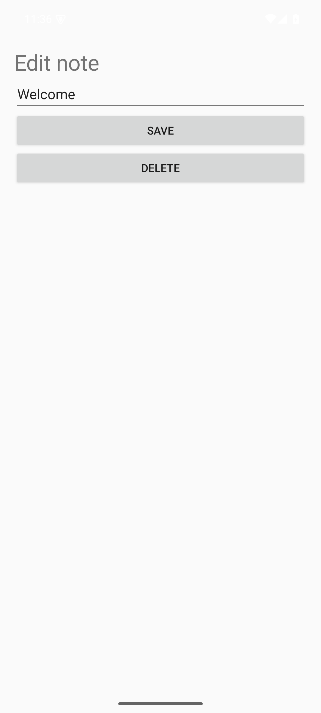
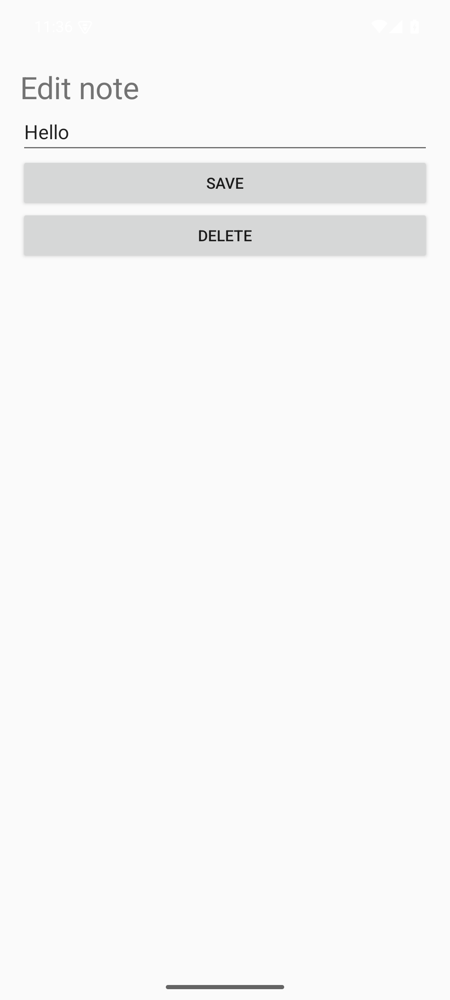
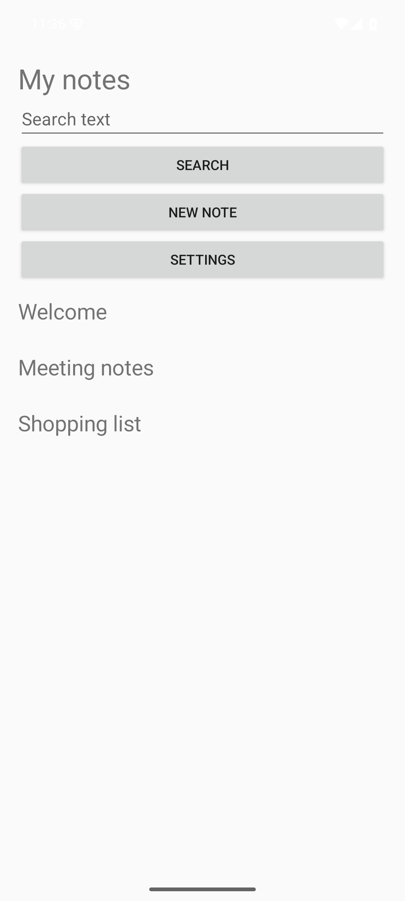

# open-the-note-called-welcome-change-its: FAIL

**Test case:** Open the note called Welcome; Change its title to Hello; Tap Save. Expected: Hello appears in the notes list and Welcome does not.

**Explanation:** The expected result states that 'Hello' should appear in the notes list and 'Welcome' should not. The screen shows 'Welcome', 'Meeting notes', and 'Shopping list'. 'Hello' is missing from the list.

Decided by: model. Steps: 4. Time: 23.2 s.

## Evidence
- `Welcome`
- `Meeting notes`
- `Shopping list`

## Steps
1. Open the note called Welcome: **tap** `Welcome`. The step is to open the note called 'Welcome'. Element 6, labeled 'Welcome', matches this description and should be tapped.
   
2. Change its title to Hello: **type** `Welcome`. The step requires changing the title of the note from 'Welcome' to 'Hello'. The input field labeled 'Welcome' (element 2) is where text can be entered or modified. Therefore, I will use the 'type' action to put the exact words 'Hello' into this element.
   
3. Tap Save: **tap** `SAVE`. The step is to 'Tap Save'. The element marked [tap] with the text 'SAVE' is present on the screen (element 3).
   
4. Check the expected result: **judge**. The expected result states that 'Hello' should appear in the notes list and 'Welcome' should not. The screen shows 'Welcome', 'Meeting notes', and 'Shopping list'. 'Hello' is missing from the list.
   
